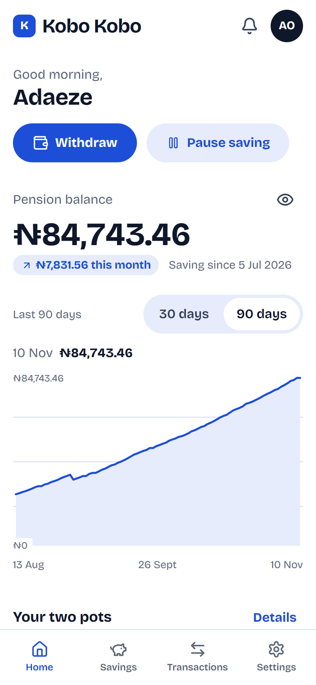
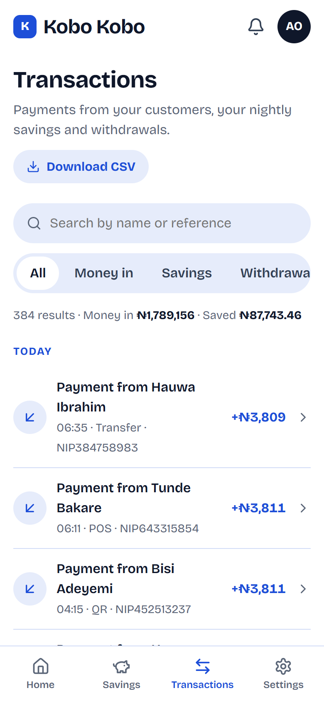
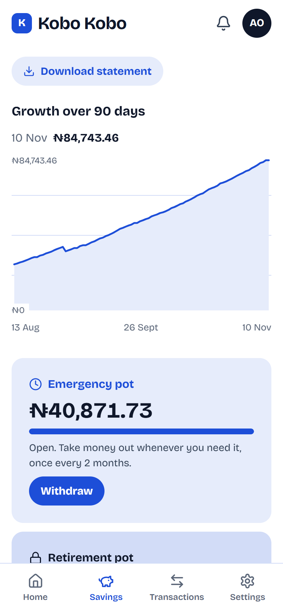
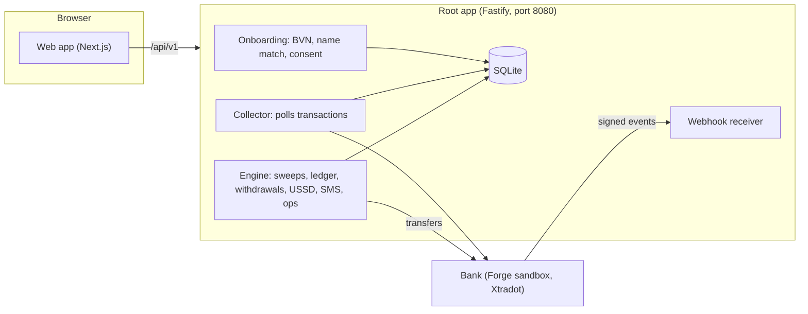

# Kobo Kobo

**Your pension grows when your sales do.**

Kobo Kobo moves a small share of a trader's daily takings into their own pension, automatically. A good day saves more, a slow day saves less, and a day with no sales takes nothing, so nothing ever bounces. It was built for **Access Youth Tech Forge 2026** (Payments and Financial Infrastructure track) by Team 07.

<p>
  
  
  
</p>

## Contents

1. [The problem](#the-problem)
2. [How it works](#how-it-works)
3. [Architecture](#architecture)
4. [The bank we build on](#the-bank-we-build-on)
5. [The web app](#the-web-app)
6. [Testing USSD and SMS](#testing-ussd-and-sms)
7. [API](#api)
8. [Run it locally](#run-it-locally)
9. [Configuration](#configuration)
10. [Deployment](#deployment)
11. [Security, privacy and compliance](#security-privacy-and-compliance)
12. [What is real and what is simulated](#what-is-real-and-what-is-simulated)
13. [How we built it](#how-we-built-it)
14. [Status and known gaps](#status-and-known-gaps)
15. [Team](#team)
16. [Credits](#credits)

## The problem

- **91.4% of personal pension accounts have never received a naira.** PenCom's Q1 2026 dashboard shows 219,316 registrations and only 18,811 (8.6%) ever funded. PenCom calls turning registration into steady contributions its central challenge.
- Pension coverage is 7.8% of Nigerian adults (EFInA, 2023).
- The people we want to reach earn unevenly: 70% of informal businesses take in under ₦50,000 a day, and 42% could not survive a month without income (Moniepoint Informal Economy Report, 2025).
- Existing channels ask for fixed, remembered payments. The newest attempt, Pension Direct, takes a fixed scheduled card debit (from ₦500 a week), which fails on slow days and gives people a reason to quit.

**The gap we found:** nobody in Nigeria makes the pension contribution a *percentage of each trader's inflows*, opted into once, inside one banking group. Rwanda's EjoHeza does something similar on mobile money, and research on defaults (Blumenstock, Callen and Ghani, 2018) found that making saving the default raised participation by about as much as a 50% matching bonus.

## How it works

1. **The trader opts in once.** They give a phone number, their BVN and the number of the bank account their customers pay into. The server verifies the BVN, checks that the BVN name matches the account name, records consent against a versioned text, and creates a simulated pension account (an RSA PIN).
2. **Sales land in the trader's own account, 100% of them.** Kobo Kobo never skims a payment on its way in. This follows the PenCom Personal Pension Plan Guidelines, section 9.3(a): contributions must be funded through the contributor's own bank account.
3. **Every night at 23:00 (Lagos time) the nightly saving runs.**
   - *Takings* are the sales received since the previous cutoff. A payment at 23:30 belongs to the next night, so nothing is missed or counted twice.
   - *Sweep* = the smaller of `floor(takings × share)` and a daily cap (default ₦5,000). The share starts at 2% and can be 1% to 5%.
   - A working-capital buffer (default ₦1,000) always stays in the account. If the sweep would dip below it, it shrinks, to nothing if need be.
   - No sales means no sweep. A paused account is skipped. A credit far above normal is held back for review (SweepGuard) and the rest of the day still counts.
4. **The money moves and is split 50/50.** The sweep is a bank transfer from the trader's account to a pension collection account. The emergency pot gets `floor(sweep / 2)`, the retirement pot gets the rest.
5. **The trader gets a receipt** with a unique reference, by SMS and in the app.
6. **Withdrawals follow the PenCom rules.** The emergency pot opens 3 months after the first contribution and then allows one withdrawal every 2 months, paid to the trader's own account. The retirement pot is locked until age 50. One function decides eligibility, so the app, USSD and SMS can never disagree.
7. **The trader stays in control.** Pause ("restock mode"), change the share, stop, or start again, on the app, by USSD, or by text.

### What happens to a sweep

```
PLANNED ─► SUBMITTED ─► SETTLED ─► (maybe) REVERSED
                    └─► FAILED
                    └─► UNKNOWN ──► requery until final (never resend)
SKIPPED_ZERO_SALES · SKIPPED_PAUSED · SKIPPED_LOW_BALANCE · HELD_GUARD
```

There is one sweep per trader per date. A sweep reuses the same idempotency key and reference on every retry, and a timeout is **requeried, never resent**, so a retry cannot take the money twice. Every state has a plain-language explanation in the app. The ledger is append-only and double-entry (`MERCHANT_BANK`, `PFA_COLLECTION`, `EMERGENCY_POT`, `RETIREMENT_POT`), pot balances are always computed from it, and a reconciliation report shows whether the books balance.

### Channels

| Channel | What it does |
|---|---|
| **Web app (PWA)** | Dashboard, savings, transactions with receipts, withdrawals, settings, notifications. Mobile first. |
| **USSD** (`*384*5050#`, simulated) | Balance, tonight's saving, change share, pause or resume, cash out. Stateless: the whole path so far is sent each time. |
| **SMS** (simulated) | `BAL`, `PAUSE`, `RESUME`, `RATE n`, `CASHOUT n`, `STOP`, `HELP`, `YES`, `NO`. English and Pidgin; other languages fall back to English. |
| **Spoken balance** | The app reads the balance aloud with the browser's speech synthesis. |
| **Operations console** | Overview and reconciliation, run the nightly saving now (with forced bank failures for the demo), sweeps table, SweepGuard alerts. |

## Architecture



The deployed backend is **one process**. The root app (`src/server.ts`) owns the database, the bank client, onboarding, the collector and the webhook receiver, and mounts the engine from `server/src/integration/root-runtime.ts`.

| Path | What is in it |
|---|---|
| `src/bank/` | The bank client: kobo/naira conversion at the boundary, one shared rate limiter, idempotent sends, "await final" for unclear transfers, paged transaction reads. |
| `src/mockbank/` | A local stand-in for the sandbox bank (transfers, identity checks, virtual accounts, webhooks, idempotency, the forced-failure triggers). |
| `src/collector.ts` | Polls transactions and stores each trader's credits. A credit is a *sale* unless its reference is one of our own (`KOBO-SWP-`, `KOBO-WD-`, `SWP-`, `WDR-`). |
| `src/onboarding/` | Consent text and version, BVN verification, name matching, keyed hash of the BVN, the enrol route. |
| `src/webhooks/` | Signed receiver with replay protection and de-duplication, registered with the bank on boot. |
| `src/pension/` | Creates the simulated pension account during onboarding, inside the same transaction. |
| `src/migrations/` | Root database migrations, including the engine tables. |
| `server/src/` | The engine: `split` (pure sweep maths), `sweeps` (engine, batch, scheduler, alerts), `ledger`, `withdrawals`, `channels` (USSD, SMS), `messages`, `guard`, `smart-rate`, `reconciliation`, `demo` (seed, clock), `routes`. |
| `server/tests/`, `tests/` | Engine tests (Vitest) and root integration tests. |
| `web/` | The Next.js web app. See [its README](web/README.md). |
| `k8s/`, `Dockerfile`, `.github/` | Deployment and CI. |
| `kobo-core/` | An earlier design (Postgres, PIN, voice). Legacy, to be removed. |

## The bank we build on

The Forge sandbox is a simulated bank ("Xtradot"), not the Access WaaS or Hydrogen APIs we first planned around. We tested it from inside the cluster and it behaves differently from what the guide and our first design assumed. These findings shaped the design:

1. **Amounts are float naira** (`5000.0`). We convert to integer kobo at the bank-client boundary (`Math.round(x * 100)`), and nothing else in the app ever sees a float.
2. **`simulate-inflow` does not credit the trader's account.** It only credits a virtual account, and settlement does not move it either. So the first design's takings source did not work.
3. **What does work** is an intra-bank transfer from another team account into the trader's account: the balance moves and a credit row appears in `GET /transactions` (type `transfer`, direction `credit`, channel `intrabank`). That is our "customer pays trader" path. It is simulated, and we say so in the demo.
4. **`GET /transactions` ignores the account filter**, so we filter client-side. One transfer writes two rows with the same reference (a credit on the receiver and a debit on the sender).
5. **Balance lookups only work for team accounts.** Anything else returns `ACCOUNT_NOT_FOUND`, so the demo uses the five team accounts.
6. **The seeded October history is not there**, only opening-balance rows. History for charts and statements therefore lives in our own database.
7. **Intrabank fees are 0**, but we read `fee`, `vat`, `stamp_duty` and `total_debit` from every transfer response anyway.

Other sandbox rules we respect: 60 requests a minute shared by the whole team (our limiter allows 40), forced-failure amounts ending `.01` to `.05` and the `DUP-` reference prefix, KYC tier limits, and the rule that a timed-out transfer is requeried, never resent. The sandbox also resets to its opening state on a restart, so our database is the source of truth.

## The web app

Next.js (App Router, TypeScript) in `web/`, designed as a real fintech product: **white and one brand blue** (everything else is derived from the single `--brand` token), **Bricolage Grotesque** as the only font, Lucide icons, Flexbox layout, no gradients, shadows or card grids, and accessible interactive charts.

| Area | Routes |
|---|---|
| Public | `/` landing, `/help`, `/terms`, `/privacy` |
| Auth | `/sign-in` (phone and text code), `/sign-up` (details, then review and agree) |
| Trader app | `/home` (dashboard), `/savings`, `/savings/withdraw`, `/transactions`, `/transactions/[id]` (receipt), `/notifications`, `/settings/*` |
| Demo | `/demo/phone` (the button phone) |
| Operations | `/ops`, `/ops/sweeps`, `/ops/alerts` |

**It runs in two modes.**

- **Mock mode (default).** The whole backend lives in the browser (`web/src/lib/api/engine.ts`) and follows the same rules as the real one. It includes a **demo bank**: when a trader signs in it seeds a linked account, months of customer payments and nightly savings, pots, a past withdrawal and statistics, so no screen is ever empty. It returns the same error codes as the server.
- **Live mode.** `NEXT_PUBLIC_API_MODE=live` talks to the real backend through `/api/v1`. Reads and settings updates are retried once on a dropped connection, money-moving calls never are. One shared summary request serves the whole app, because each summary costs the server a bank call.

**Installable.** The web app has a manifest with 192px, 512px and maskable icons and a small service worker, so Chrome and Android offer "Install" (Settings, About has a button) and iPhone can Add to Home Screen. Offline it shows a plain "You are offline" page. The service worker never caches the API or personal pages, and it only registers in production builds.

**Demo controls** (simulate a customer paying, run tonight's saving, skip time, reset) are behind a switch in Settings, About, and in live mode need the shared demo key or an open server. They stay out of the way of a normal trader.

Details, including every route and the full API table, are in [web/README.md](web/README.md).

## Testing USSD and SMS

There is no mobile network, so both channels are simulated. They run the same code the app uses, so a refusal reads the same on every channel.

**On screen (easiest).** Turn on demo controls (open `/sign-in?demo=1` once), then open **Button phone** (`/demo/phone`). Pick a trader, dial `*384*5050#` and follow the menu: 1 balance, 2 tonight's saving, 3 change share, 4 pause or resume, 5 cash out, 6 spoken balance. `0` goes back and `99` returns to the main menu. The SMS tab takes `BAL`, `PAUSE`, `RESUME`, `RATE 3`, `CASHOUT 5000`, `STOP`, `HELP`, `YES`, `NO`.

**Against the API.** The phone number must belong to an enrolled trader. The four demo traders are seeded on boot with phones `+2348000000001` to `+2348000000004` (Adaeze, Babatunde, Musa, Efosa):

```bash
# USSD: "text" is the whole path so far, "" opens the menu
curl -s localhost:8080/api/v1/ussd -H 'content-type: application/json'   -d '{"phoneNumber":"+2348000000001","text":"1"}'
# add ?format=text to get the raw "CON ..." / "END ..." a telco expects

# SMS
curl -s localhost:8080/api/v1/sms/inbound -H 'content-type: application/json'   -d '{"from":"+2348000000001","text":"BAL"}'
```

**Things worth trying.** `CASHOUT 5000` on a new trader (refused with the vesting rule, the same sentence as in the app); `PAUSE` then `RESUME`; `RATE 6` (refused, the share is 1% to 5%); `STOP` then `YES`. `server/scripts/smoke.mjs` drives the same calls end to end, and `server/tests` has the unit tests.

## API

Base path `/api/v1`. Success is `{ "status": "success", "data": ... }` and failure is `{ "status": "error", "error": { "code", "message", "field"? } }`. Money is integer kobo, and every time the web app reads is epoch milliseconds.

| Call | Purpose |
|---|---|
| `GET /consent`, `POST /merchants/onboard` | Sign up: BVN, name match, consent. Returns the new trader. Limited to 5 attempts a minute per address. |
| `POST /auth/verify-otp` | Sign in with a phone number and a code (`123456` in the demo). |
| `GET /merchants/:id/summary`, `/activity`, `/feed` | The dashboard, the sweeps and the account feed. |
| `PATCH /merchants/:id/settings` | Share, language, pause (`pauseHours`, `0` resumes), stop, restart. Returns the summary. |
| `POST /withdrawals` | `{ merchantId, amountKobo }`. A refusal is a normal answer (`ok: false` with the same sentence USSD and SMS show). |
| `POST /ussd`, `POST /sms/inbound` | The phone channels. |
| `GET /ops/overview`, `POST /ops/sweeps/run`, `POST /ops/sweeps/:id/requery`, `POST /ops/alerts/:id/resolve`, `GET /ops/reconciliation` | Operations. |
| `GET/POST /demo/clock`, `POST /demo/inflow`, `POST /demo/reset`, `GET /demo/traders`, `POST /demo/sign-in` | Demo controls. |
| `GET /healthz` | Health check. |

Onboarding errors: `IDENTITY_NOT_VERIFIED`, `ACCOUNT_NOT_FOUND`, `ACCOUNT_NOT_ACTIVE`, `NAME_MISMATCH`, `NAME_NEEDS_REVIEW`, `ALREADY_ENROLLED`, `CONSENT_REQUIRED`, `CONSENT_VERSION_MISMATCH`, `INVALID_REQUEST`, `RATE_LIMITED`, `BANK_UNAVAILABLE`.

`docs/TEAM.md` is the team's handoff and has the engine details.

## Run it locally

Node 22 is what the image uses.

**Web app on its built-in mock (nothing else needed):**

```bash
cd web
npm install
npm run dev          # http://localhost:3000
```

Sign in with "Use a demo account" (or open `/sign-in?demo=1` once). The demo accounts are the sandbox's four synthetic traders.

**Backend with the mock bank:**

```bash
npm ci
npm run mockbank                       # mock bank on :4010 (header x-api-key, default key "mock-key")

# in another terminal
export BANK_BASE_URL=http://127.0.0.1:4010/v1 BANK_API_KEY=mock-key
export DB_PATH=./kobo.sqlite IDENTITY_HMAC_KEY=any-local-secret DEMO_MODE=1
npm run dev                            # http://localhost:8080
```

`better-sqlite3` is a native module. On Windows you need the Visual Studio "Desktop development with C++" workload to install it.

**Web app on the real backend (live mode):**

```bash
cd web
NEXT_PUBLIC_API_MODE=live API_BASE_URL=http://localhost:8080 npm run dev
```

**Tests and checks:**

```bash
npm test                         # root integration tests
npm run build                    # root typecheck
cd server && npm test            # engine tests (Vitest)
cd server && npx tsc --noEmit
cd web && npm run typecheck && npm run build
```

`server/scripts/smoke.mjs` is an end-to-end smoke test against a running server.

## Configuration

| Variable | Meaning |
|---|---|
| `PORT` | HTTP port (8080). |
| `DB_PATH` | SQLite file. `/data/kobo.sqlite` in the container, on durable storage. |
| `BANK_BASE_URL`, `BANK_API_KEY` or `GATEWAY_KEY` | The bank and its key. Production refuses to boot without a key. |
| `OPS_TOKEN` | Secret for ops and demo-control routes. Production refuses to boot without it. |
| `DEMO_MODE` | `1` enables demo routes and seeds the demo traders on boot. |
| `DEMO_SECRET` | Shared key sent as `x-demo-key` for demo actions. |
| `IDENTITY_HMAC_KEY` | Secret used to hash BVNs. Set it before onboarding anyone. |
| `COLLECTION_ACCOUNT` | The stand-in pension collection account (default `0123456793`). |
| `GUARD_HOLD_ABOVE_NAIRA` | Placeholder SweepGuard: hold any single credit at or above this amount. |
| `SCHEDULER_ENABLED`, `SWEEP_CRON`, `SWEEP_RETRY_CRON`, `REQUERY_CRON` | Defaults: sweep at 23:00, retry at 23:30, requery every minute. |
| `NEXT_PUBLIC_API_MODE`, `API_BASE_URL` (web) | `live` switches the web app to the real API. **Read at `next build`, not at start.** |

Never commit `GATEWAY_KEY`, the webhook secret, a kubeconfig or `.env`.

## Deployment

- **Image.** The root `Dockerfile` builds the backend (Node 22, root app plus `server/src`). GitHub Actions (`.github/workflows`) runs the checks on every pull request and publishes `ghcr.io/daodudestiny56-netizen/kobo-kobo` on pushes to `main`.
- **Cluster.** `k8s/app.yaml` deploys one replica as the public service `app` (port 80 to 8080) in the Forge namespace, with a 1 GiB volume for the database and secrets for the gateway key and the app's own keys. The sandbox allows one public service per team (`https://team07.xtradot.co`), 10 pods, and a small CPU and memory quota.
- **The web app is not in that image yet.** It is a separate Next.js build. It needs `NEXT_PUBLIC_API_MODE=live` and `API_BASE_URL` set **as build arguments**, because both are fixed at build time.

## Security, privacy and compliance

- **We never take money before it reaches the trader.** Sales settle into their own account, then the share is moved (PenCom PPP Guidelines s.9.3(a)).
- **Consent is explicit and versioned.** The text and its version come from the server, and what the person saw is what is recorded. Stopping is as easy as starting.
- **Identity.** The BVN is verified, the name is matched against the account name, and only a keyed hash of the BVN is stored.
- **Money safety.** Integer kobo throughout, idempotency keys on every transfer, requery instead of resend after a timeout, an append-only double-entry ledger, and a reconciliation report. Webhooks are signature-checked, timestamp-checked and de-duplicated.
- **Fraud.** A credit far above a trader's normal day is held for review (SweepGuard) while the rest still counts.
- **Data.** Only synthetic data is used in the sandbox, and secrets are never in the repository.
- **Approvals a real launch still needs.** PenCom approval of any POS-linked or settlement-linked channel (s.8) and confirmation that a settlement-linked sweep satisfies s.9.3(a), and a service agreement between the pension fund administrator and any accredited pension agent.

## What is real and what is simulated

| Part | Status |
|---|---|
| Bank accounts, transfers, balances, identity checks, webhooks | **Forge sandbox** (a simulated bank with synthetic data) |
| Customer payments | **Simulated** (a real transfer between team accounts in the sandbox) |
| Sweep engine, ledger, split, receipts, withdrawal rules, reconciliation | **Built by us** |
| Access ARM pension account and RSA PIN | **Simulated** |
| USSD and SMS | **Simulated**, on-screen, no mobile network |
| Spoken balance | Browser speech synthesis |
| SweepGuard and SmartRate | **Placeholders** today (see below) |

## How we built it

**1. Research and choosing the idea.** We started from the Forge brief and compared 17 ideas across the three tracks (payments, climate-linked finance, creative technology). We chose payments and a pension that follows sales ("pension at the till"), after finding the 91.4% figure, the competitor's fixed-debit weakness and a regulatory path that works: sweep from the trader's own account. The application, pitch deck and trader-interview plan came out of that.

**2. Design.** A product requirements document defined the flow, the rules and the 72-hour plan. When we tested the real sandbox it contradicted our first assumptions (the findings above), so we reworked the design around what the bank actually does.

**3. Backend.** In order: the bank client and a mock bank, the transaction collector with the sale rule, identity checks, the signed webhook receiver, and onboarding with consent. Then the engine: sweep maths, the double-entry ledger, the sweep state machine with requery, withdrawals with one eligibility rule, USSD and SMS, reconciliation, and a seeded demo. Then the integration into the root app, simulated pension accounts at onboarding, the volume for the database, CI, and the image.

**4. Frontend.** We researched real fintech products first, then built the web app: pages for every part of a financial product, a demo bank in the mock so every screen has real data, interactive charts, and a design system that went from a warm palette to white and one blue at the team's request. It was tested in a real browser at phone, tablet and desktop sizes, with scripted flows for sign-up, dashboards, withdrawals, settings, operations and the button phone.

**5. Making the two halves meet.** We moved sign-up onto the real onboarding contract, with every server error code explained in plain language. Then we ran the web app against the real backend and its mock bank (18 scripted live checks and 8 sign-up checks) and fixed what that turned up:
- the server was called twice per page for the summary, so we load it once for the whole app;
- a proxy between the web app and the server sometimes dropped connections, so reads and settings updates are retried (money-moving calls never are);
- the bank returns names in capitals, so they are shown the way a person writes them;
- ops and demo calls can be protected by a key, so the app asks for it only when the server says it needs one;
- a trader who no longer exists (after a demo reset) signs the person out cleanly.

## Status and known gaps

As of 11 November 2026:

- **The web app's live mode needs the "web contract" API change**, which adds the sign-in code, summary, feed, activity, demo sign-in and ops overview endpoints in the shapes the web app reads. It was written and tested against the real backend, but was **not yet merged** when this README was written. Until it is, only the mock mode and onboarding run end to end.
- **SweepGuard and SmartRate** are placeholders: a simple threshold guard and a stored suggestion. The statistical versions are still to be built.
- **The web app is not part of the deployed image.**
- **`kobo-core/`** (the earlier design) should be removed, and parts of `docs/TEAM.md` describe an older API shape.
- **Not yet verified:** the Docker build and cluster deploy of the combined app, and the smoke test against the live sandbox.
- **Phone verification** at sign-in uses a demo code.
- **Languages:** Yoruba, Hausa and Igbo messages fall back to English.
- **Legal pages** (terms, privacy) are drafts and have not been reviewed by a lawyer.

## Team

| Person | Area |
|---|---|
| Destiny | Web app (PWA), simulators, operations dashboard, the demo |
| Abiodun | Bank client, webhooks, onboarding |
| Caleb | The pension engine, deployment and CI |
| Tomiwa | SweepGuard, SmartRate, message copy |

## Credits

- **Photography** (Wikimedia Commons, CC BY-SA 4.0): DanteOlolo, Oludeleadewalephotography and Azzawaady.
- **Font:** Bricolage Grotesque (SIL Open Font License). **Icons:** Lucide.
- **Data sources:** PenCom (Q1 2026 dashboard, 2025 Personal Pension Plan Guidelines), EFInA Access to Financial Services in Nigeria 2023, Moniepoint Informal Economy Report 2025, Blumenstock, Callen and Ghani (American Economic Review, 2018).
- Built with Next.js, React, Fastify and SQLite.
